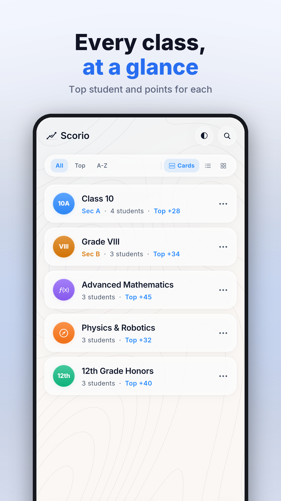
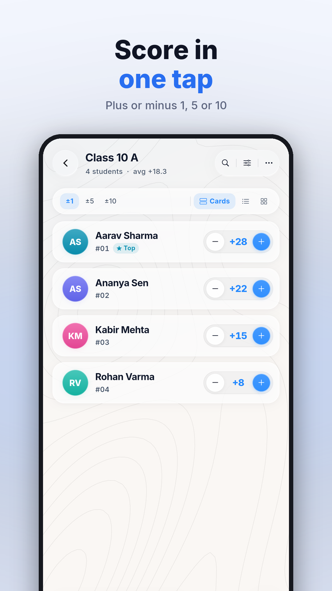
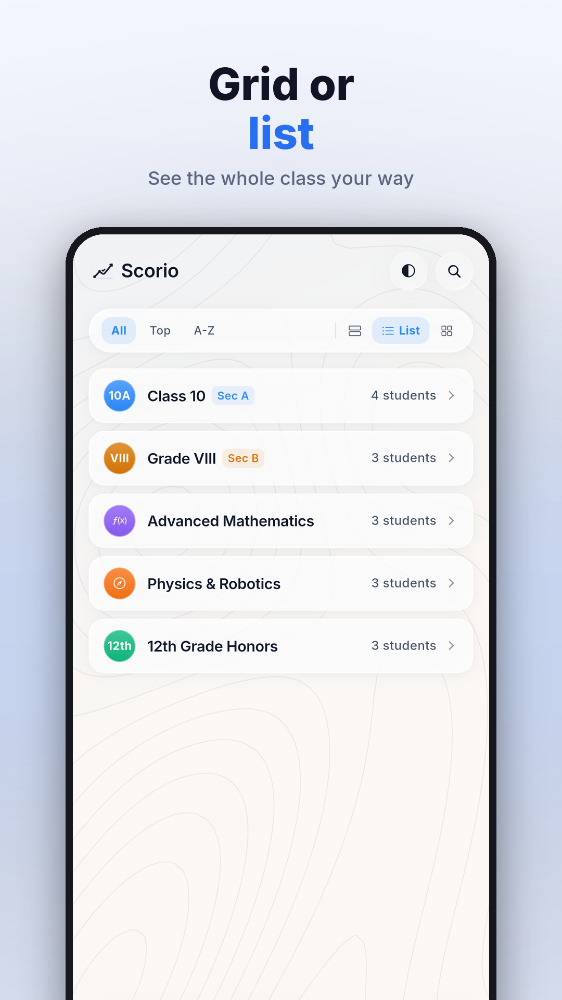
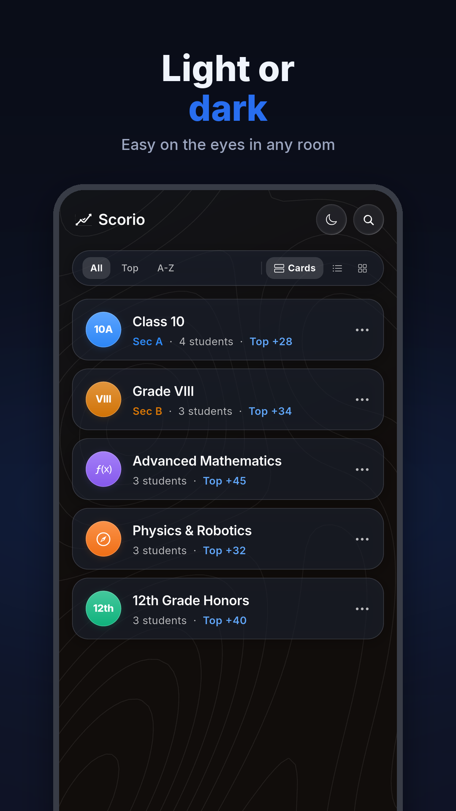
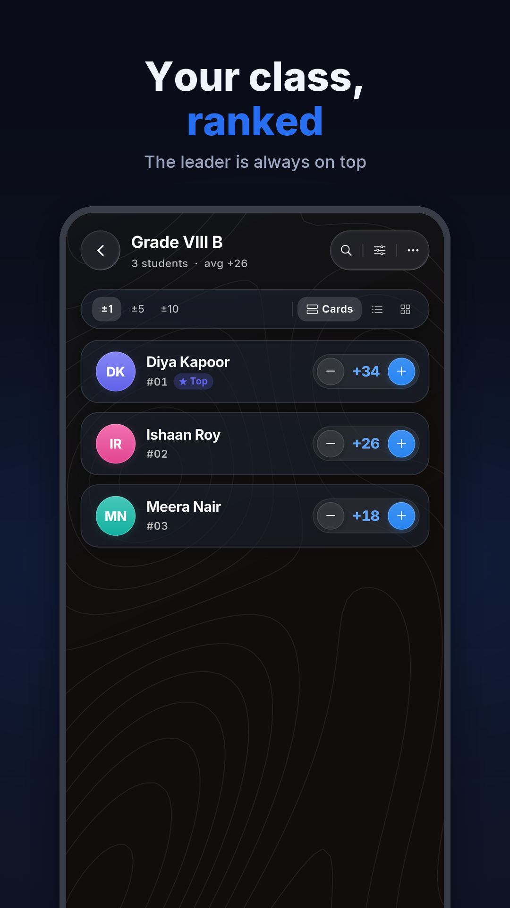
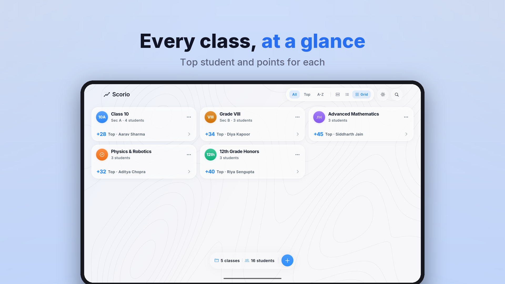

# Scorio

A quick scoreboard for classes on Android. Give points in one tap and always see who is on top. No ads, no account, works offline.

<p>



</p>
<p>


</p>



## Download

Get the latest APK from [Releases](https://github.com/GagandeipSingh/scorio/releases/latest). Most phones use the **arm64-v8a** file. Requires Android 7.0 or newer.

## Features

- **Every class at a glance:** the top student and points for each class
- **Score in one tap:** plus or minus 1, 5 or 10
- **Ranked:** the leader is always marked, and you can sort by top score or A to Z
- **Your view:** cards, list or grid
- **Search:** find any class or student
- **Light or dark:** or follow your phone
- **Any screen:** phones, tablets and foldables

## Build

```
flutter pub get
flutter run
```

Release builds read signing details from `android/key.properties`, which is not in this repo. Without it, release builds fall back to the debug key.

## Privacy

Scorio asks for no permissions and collects no data. Classes and scores stay on your device.
